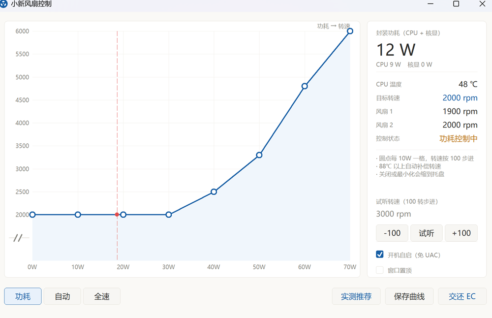

# FanCtrl · 小新风扇控制

一个给联想小新（IdeaPad）笔记本用的风扇曲线工具。单文件 exe，约 220 KB，零额外依赖。

针对机型验证：**联想小新 Pro 14 GT（83SH）**，Intel Core Ultra X7 358H（Panther Lake），
BIOS STCN29WW，Windows 11 26300。



> 实测数据（转速 ↔ 温度 ↔ 负载的完整关系）见 [docs/thermal.md](docs/thermal.md)。

## 为什么需要它

小新原厂的风扇策略有两个硬伤：

1. **目标转速偏高**：性能档下 80 ℃ 就会拉到 5800 / 6000 rpm。
2. **降速是固定斜率**，与温度无关。实测停载后温度 1 秒内从 82 ℃ 掉到 48 ℃，
   风扇仍要再转 **82 秒**才回到最低转速。

结果就是「电脑明明已经不热了，风扇还在啸叫」。原厂软件（联想电脑管家、Lenovo Legion Toolkit）
都只能切档位，改不了曲线——因为 BIOS 没有向它们暴露风扇表。

本项目绕过这一限制：直接写 BIOS 的 ACPI 功能接口，自己指定目标转速。

## 功能

- 9 段温度曲线（20–100 ℃，每 10 ℃ 一个节点），鼠标拖动即可修改
- 实时显示 CPU 封装温度、两只风扇转速、当前目标转速
- 三种模式：曲线控制 / 交还 EC / 全速
- 超温保护：温度达到阈值（默认 92 ℃）自动交还 EC
- 配置保存到 `settings.ini`，随 exe 同级
- 可缩放窗口、可置顶
- **托盘常驻**：关闭或最小化只缩到托盘，曲线继续生效；托盘图标悬停显示实时温度/转速，
  右键可直接切模式、开关自启、退出
- **开机自启**：以计划任务方式注册（当前用户 + 最高权限），开机后 20 秒自动进入托盘，
  **不弹 UAC**
- **单实例**：重复启动只会唤起已有窗口
- 退出时自动交还 EC 控制

## 构建

需要 Visual Studio Build Tools 的 C++ 组件（含 Windows SDK）。

```cmd
build.cmd
```

产物：`FanCtrl.exe`（静态链接 CRT，无运行时依赖）。

## 运行

双击 `FanCtrl.exe`（或桌面快捷方式），会弹出 UAC 请求管理员权限——这是必需的，
exe 内嵌了 `requireAdministrator` 清单，不加权限读不到温度也控制不了风扇。

首次运行会在同目录生成 `settings.ini`。

命令行参数：

| 参数 | 作用 |
|---|---|
| `/tray` | 启动后不进主界面，直接待机在托盘（开机自启用的就是它） |

## 托盘与开机自启

- 点窗口的 **×** 或 **最小化** 都只是缩到托盘，控制不中断。首次缩小时会弹一次气泡提示。
- 托盘图标：**左键单击/双击**打开主窗口，**右键**弹出菜单（切模式、开机自启、退出）。
- 主界面右侧勾选 **开机自启（免 UAC）** 即写入计划任务 `FanCtrl`：

  ```
  触发器    登录时，延迟 20 秒
  主体      当前用户，RunLevel = 最高权限
  动作      "…\FanCtrl.exe" /tray
  ```

  用的是进程内 `ITaskService` COM 接口注册，不起子进程、不弹控制台。
  取消勾选即删除任务。任务状态不做缓存，每次启动都向系统查询。

## 技术实现

### 温度：PawnIO 驱动 + MSR 直读

CPU 温度在 DTS 传感器里，只能在内核态用 `RDMSR` 读取，用户态没有任何 API 可用。

程序通过 [PawnIO](https://pawnio.eu)（一个签名驱动）加载官方 `IntelMSR` 模块，
再用 `DeviceIoControl` 让驱动代为执行 `RDMSR`：

| MSR | 含义 |
|---|---|
| `0x1A2` | IA32_TEMPERATURE_TARGET，取 TjMax（本机 100 ℃） |
| `0x1B1` | IA32_PACKAGE_THERM_STATUS，封装温度 = TjMax − bits[22:16] |

模块（4 KB）以资源形式内嵌在 exe 中，运行时直接喂给驱动，不落盘。

> 注意：PawnIO 需要单独安装（[下载](https://pawnio.eu/)）。程序不会自动安装驱动。

### 风扇：WMI → ACPI

```
ROOT\WMI : LENOVO_OTHER_METHOD   (ACPI\PNP0C14\GMZN)
  GetFeatureValue(IDs)            -> value
  SetFeatureValue(IDs, value)     -> bool
```

| 功能 ID | 对象 | 范围 |
|---|---|---|
| `0x04030001` | 风扇 1 | 0–5700 rpm |
| `0x04030004` | 风扇 2 | 0–6000 rpm |

- 槽位编号是**逻辑编号**，不是 1、2 连号。`0x04030002` 存在但无风扇（cap=0）。
- 写非零值进入**手动模式**，且是**全局开关**——只写一个 ID 会让另一只风扇冻结在旧值。
  所以必须同时写两个 ID。
- **写 0 = 交还 EC 自动控制**，不是停转。

### 一个坑：WMI 参数类型

这个类的 `uint32` 参数只接受 `VT_I4`，用 `VT_UI4` 会返回 `WBEM_E_TYPE_MISMATCH (0x80041005)`，
表现为 `ExecMethod` 报参数无效。

## 风险与边界

- 只写官方 ACPI 功能接口，**不碰 EC 端口 0x62/0x66**，不写裸寄存器。
- 写入值被 BIOS 钳位，不会造成风扇物理损坏。
- 真正的风险是**状态残留**：手动转速在程序异常退出后不会自动恢复，需重启才回到 EC 控制。
  本程序在正常退出、超温、切换到「自动」时都会写 0 交还控制。
- 手动模式为运行时状态，**不跨重启**。

## 目录结构

```
FanCtrl/
  src/        main.cpp   窗口、绘制、交互、控制循环
              tray.cpp   托盘图标（运行时绘制）、右键菜单、计划任务
              sensor.cpp PawnIO + MSR 读温度
              fan.cpp    WMI 读写风扇
              config.cpp settings.ini 读写
              app.h      共享状态与接口
  res/        app.rc、app.ico（多尺寸图标）、app.manifest（管理员清单）、IntelMSR.bin
  build.cmd   一键编译
  .gitignore
```

编译时加 `/DFANCTRL_DEBUG` 会额外输出 `tray_debug.log`、`fan_debug.log`，
以及把生成的图标导出成 `icon_render.bmp` 便于检查。

托盘图标不是外部资源，而是启动时用 4×4 超采样逐像素算出来的（蓝色圆底 + 白色三叶风扇），
所以 exe 里没有 `.ico` 文件。

## 许可

代码部分可自由使用。内嵌的 `IntelMSR.bin` 来自 LibreHardwareMonitor，
遵循其原始许可（MPL-2.0）；PawnIO 驱动为 GPL-2.0 并带模块例外条款。
